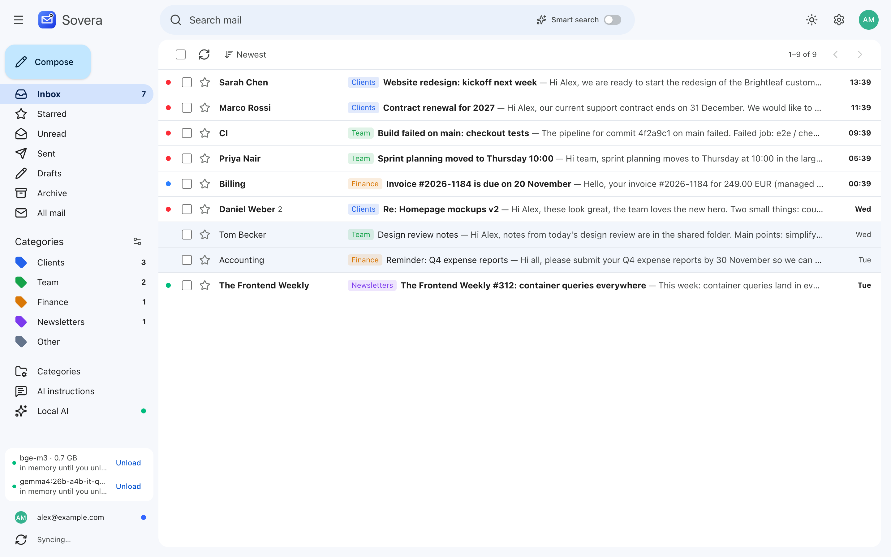
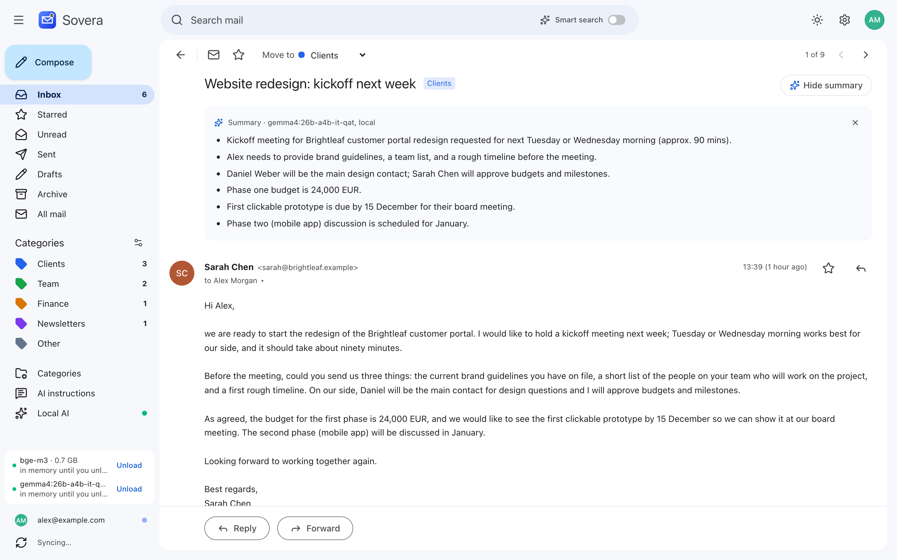
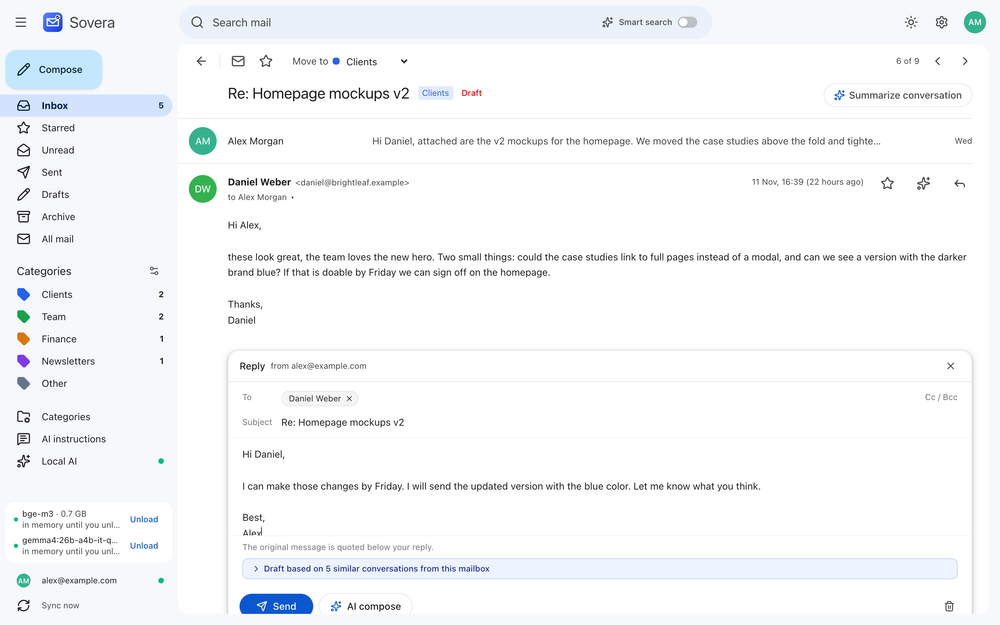

<p align="center">
  
</p>

<h1 align="center">Sovera Mail</h1>

<p align="center">
  <strong>The open-source mail client with a private AI that runs on your own computer.</strong><br>
  Gmail and IMAP · drafts in your own voice · summaries · smart categories · smart search
</p>

<p align="center">
  <a href="LICENSE"></a>
  
  
  
  
  
</p>

<p align="center">
  
</p>

<p align="center"><sub>Screenshots show a demo mailbox with made-up people and companies.</sub></p>

---

Sovera Mail copies your mailbox into a database **on your own machine** and gives it an AI
assistant that also runs **on your own machine**, through [Ollama](https://ollama.com). It
writes replies the way you write, summarizes long threads, sorts mail into your own categories
and finds mail from a description in plain words. No cloud AI, no telemetry, no account with us.

- [Why Sovera Mail](#why-sovera-mail)
- [Features](#features)
- [Quick start](#quick-start)
- [Installation](#installation)
- [Configuration](#configuration)
- [Development](#development)
- [Security & privacy model](#security--privacy-model)
- [How AI compose works](#how-ai-compose-works)
- [Contributing](#contributing)
- [License](#license)

## Why Sovera Mail

- **Private by design.** Your mail and the AI that reads it never leave your computer (or a
  server you own). The code is open, so you can check that.
- **AI that sounds like you.** Drafts are built from how *you* write to *this* person, from a
  style profile learned from your sent mail and from every correction you made to earlier drafts.
- **You stay in control.** The AI runs only when you click **Process new**. Nothing is ever
  sent without your confirmation, and nothing is ever deleted.

## Features

<table>
  <tr>
    <td width="50%" valign="top">
      
      <p><strong>Summaries.</strong> One line per fact for a whole conversation or a single message:
      what is asked of you, dates, amounts, names, decisions.</p>
    </td>
    <td width="50%" valign="top">
      
      <p><strong>AI compose.</strong> A reply in your own voice, drafted from the thread, your
      earlier mail to the same person and similar conversations in your mailbox.</p>
    </td>
  </tr>
</table>

- **Your mailboxes:** Gmail (Google OAuth) and any IMAP/SMTP account: iCloud, Yahoo, Fastmail,
  Zoho, GMX, Proton Mail Bridge or your own server.
- **A complete mail client:** conversations, read/unread, stars, labels and folders, reply,
  reply all, forward, drafts, attachments with risk screening.
- **Categories and urgency:** define your own categories in plain words; the local model files
  every conversation and colours unread mail by urgency (high / medium / low). Your manual
  choices always win and teach the model.
- **Search two ways:** instant keyword search, or **smart search** that understands a
  description like *"the mail about the planned server downtime"*.
- **Knowledge about you:** your roles, projects, recurring questions and usual answers, and
  cards for the people you write to most, all editable.
- **Any language:** drafts follow the language of the mail (or the one you choose), and an
  optional proofreading pass helps small models outside English.

## Quick start

You need [Docker](https://docs.docker.com/get-docker/) and, for the AI features,
[Ollama](https://ollama.com).

```bash
git clone https://github.com/hljubic/soveramail.ai.git
cd soveramail.ai
cp .env.example .env          # add your Google OAuth keys here if you use Gmail
docker compose up -d --build
```

Open <http://localhost:3000>, add a mailbox under **Accounts**, then pick your models under
**Local AI**:

```bash
ollama pull qwen3:8b      # chat model: drafts, categories, summaries
ollama pull bge-m3        # embedding model: smart search
```

The sections below explain each step in detail.

## Installation

### 1. Google Cloud setup (Gmail only)

Skip this if you only use IMAP accounts.

1. Go to <https://console.cloud.google.com/> and create a project.
2. **APIs & Services → Library** → enable the **Gmail API**.
3. **APIs & Services → OAuth consent screen** → External, fill in an app name and your
   e-mail. Add the scopes `.../auth/gmail.modify`, `.../auth/userinfo.email`,
   `.../auth/userinfo.profile`, `openid`. (`gmail.modify` = read mail, mark read/unread,
   labels and send; it cannot permanently delete.) While the app is in *Testing* mode,
   add every Gmail address you want to connect under **Test users**.
4. **APIs & Services → Credentials → Create credentials → OAuth client ID**, type
   **Web application**, authorized redirect URI (exactly):

   ```
   http://localhost:8090/api/auth/google/callback
   ```

5. Copy the *Client ID* and *Client secret* into `.env` (next step).

### 2. Run it

Requirements: Docker (Docker Desktop on macOS / Windows).

```bash
cp .env.example .env            # then edit: GOOGLE_CLIENT_ID, GOOGLE_CLIENT_SECRET, UID/GID (id -u / id -g)
docker compose up -d --build
```

Then open <http://localhost:3000>.

| Service     | Purpose                                                   | Host address          |
| ----------- | --------------------------------------------------------- | --------------------- |
| `mysql`     | MySQL 8.4                                                 | 127.0.0.1:3307        |
| `api-init`  | composer install, APP_KEY, migrations                     | one-shot              |
| `api`       | PHP-FPM                                                   | –                     |
| `nginx`     | HTTP front for the API                                    | http://localhost:8090 |
| `queue`     | mail jobs: sync, send                                     | –                     |
| `queue-ai`  | local AI jobs: processing, re-sort, index                 | –                     |
| `scheduler` | fetches new mail every 5 min while the UI is open         | –                     |
| `web`       | Nuxt dev server                                           | http://localhost:3000 |

Everything is bound to `127.0.0.1` only. Health check: <http://localhost:8090/api/health>.
The first start installs Composer and npm dependencies inside the containers and takes
a couple of minutes. Your mail lives in the `mysql-data` volume; it survives restarts
and `docker compose down` (only `make reset` deletes it, after asking).

#### Connecting Gmail

1. **Accounts → Connect Gmail** opens Google's consent screen in a new tab.
2. After consent Google redirects to the local API, which stores the encrypted tokens
   and queues the first sync (newest `MAIL_SYNC_INITIAL_LIMIT` messages, default 100).
   The tab closes itself and the accounts page picks up the new mailbox.
3. New mail is fetched when the UI opens and then every 5 minutes while it stays open.
   **Accounts → Fetch N older messages** back-fills further into the past.

#### Connecting an IMAP/SMTP mailbox

**Accounts → Add IMAP account.** Pick a preset or enter your own servers. Most
providers require an *app password* instead of the login password. The API logs in to
both the IMAP and the SMTP server before anything is stored; credentials then live
encrypted (`APP_KEY`) and never appear in API responses.

Folders become labels (Inbox, Sent, Drafts, Trash, Junk are recognised by SPECIAL-USE
attributes or name), `\Seen`/`\Flagged` map to unread/starred, threads come from
`References`/`In-Reply-To`, new mail is pulled by UID above a per-folder cursor.
Sending goes through SMTP and the copy is appended to Sent. The backend never deletes,
moves or expunges anything.

### 3. Set up the local AI (optional)

1. Install [Ollama](https://ollama.com) and pull a chat model and an embedding model, e.g.

   ```bash
   ollama pull qwen3:8b      # chat: drafts, categories, summaries (16 GB RAM)
   ollama pull bge-m3        # embeddings: smart search, related conversations
   ```

   Bigger machines can use a bigger chat model. Prefer GGUF builds: the categories,
   urgency and summaries use Ollama's JSON-schema output.
2. Open **Local AI** in the sidebar, keep the server URL
   (`http://host.docker.internal:11434`; `localhost` is rewritten to it because the API
   runs in Docker), press **Test connection**, pick the models and **Save**.
3. Click **Process new** in the top bar. One pass sorts new mail into categories,
   rates urgency, writes summaries, builds your writing style and what the AI knows
   about you, and indexes mail for smart search.

On Linux, Ollama must listen on an address Docker can reach, e.g. `OLLAMA_HOST=0.0.0.0`.
By default the model server has to be on this machine or your private network; set
`AI_ALLOW_REMOTE=true` only for a server you control (mail content is sent to it).

## Configuration

Root `.env` (used by docker compose):

| Variable                     | Default                  | Meaning                                              |
| ---------------------------- | ------------------------ | ---------------------------------------------------- |
| `GOOGLE_CLIENT_ID/SECRET`    | –                        | OAuth client (Web application)                       |
| `API_URL`                    | `http://localhost:8090`  | must match the redirect URI registered at Google     |
| `WEB_URL`                    | `http://localhost:3000`  | where the UI runs (CORS, OAuth return page)          |
| `MAIL_SYNC_INITIAL_LIMIT`    | `100`                    | how many newest messages the first sync pulls        |
| `MAIL_SYNC_INTERVAL_MINUTES` | `5`                      | interval of the scheduled fetch (only while the UI is open) |
| `MAIL_SYNC_BATCH_PAUSE_MS`   | `600`                    | pause between download batches (Gmail quota); rate-limit replies are retried with backoff |
| `AI_ALLOW_REMOTE`            | `false`                  | allow a model server outside this machine / private network |
| `SOVERA_TIMEZONE`            | `UTC`                    | your time zone, for "today" and deadlines in AI prompts |
| `API_KEY`                    | empty                    | optional shared secret (`X-Api-Key`) for the API     |
| `CHOKIDAR_USEPOLLING`        | `false`                  | set `true` if HMR misses file changes in Docker      |

## Development

```bash
make test        # Laravel test suite (in-memory SQLite)
make lint        # Pint
make restart     # restart api, queue workers and scheduler after backend changes
make logs        # follow all containers
make sync        # run a sync now and print stats
make shell       # bash inside the API container
make test-mail   # also run IMAP/SMTP integration tests against a throwaway GreenMail server
make remove-account EMAIL=you@gmail.com          # delete the local copy of a mailbox (Gmail untouched)
make remove-account EMAIL=you@gmail.com KEEP=1   # disconnect only; keep the mail on disk
```

The queue workers and the scheduler are long-running PHP processes: after changing
backend code run `make restart`, or they keep running the old code.

Useful artisan commands (inside the container):

```bash
php artisan sovera:sync-accounts --now                       # incremental, all accounts
php artisan sovera:sync-accounts --now --mode=backfill --limit=200
php artisan sovera:process                                   # same as "Process new"
```

`App\Services\Mail\Providers\MailProvider` is the one interface a mailbox backend
implements (`sync`, `send`, `saveDraft`, `fetch`, `setFlag`, `fetchAttachment`).
Everything above it (local store, idempotent sending, the no-delete guarantee,
attachment screening, AI) is shared, so another backend is one more class.

## Security & privacy model

Exactly this leaves your computer, and why:

| Destination                 | What                                             | When                                              |
| --------------------------- | ------------------------------------------------ | ------------------------------------------------- |
| `accounts.google.com`       | OAuth consent                                    | when you connect / reconnect a Gmail account      |
| `gmail.googleapis.com`      | mail download, read/star state, explicit sends   | while the UI is open, and sends only after confirmation |
| your IMAP / SMTP server     | mail download, read/flag state, explicit sends   | IMAP accounts only                                |
| `lh3.googleusercontent.com` | your own profile picture (no referrer)           | when the account avatar is shown                  |
| your Ollama server          | mail text for drafts, summaries, categories, index | only when you use an AI feature or click *Process new* |

No telemetry, no crash reporting, no update checks, no cloud sync.

Guarantees built into the code (covered by tests):

- **Nothing is ever sent automatically.** Sending is reachable only from the explicit
  Send actions; every send shows a confirmation, needs a one-use idempotency key and is
  rate-limited, so a network retry cannot send the same message twice. Sync, scheduler
  and AI never call the send path (a test scans the source for this).
- **Nothing is ever deleted.** The app has no delete or trash action and the API no
  `DELETE` for messages; the Gmail client refuses every label change except read/unread
  and starred. Mail deleted on the server is only hidden locally. **Remove account**
  asks whether to keep the local copy; the server mailbox is untouched either way.
- **The local API is fenced off from websites.** Every request needs an allow-listed
  `Host` (defeats DNS rebinding) and `Origin`, and every state-changing call the
  `X-Sovera-Client` header (forces a CORS preflight). Optional `API_KEY` on top.
- **AI stays on the device** unless you set `AI_ALLOW_REMOTE=true`. Retrieval is scoped
  to the account you write from; mailboxes are never mixed.
- **Tokens and passwords are encrypted at rest** (`APP_KEY` in `api/.env`: back it up,
  never commit it) and never appear in API responses.
- **Reading never changes the mailbox.** IMAP fetches with `BODY.PEEK[]` and issues no
  DELETE, EXPUNGE, COPY or MOVE.
- **Attachments are screened and never fetched on their own.** Sync stores metadata
  only; bytes are downloaded when you preview, download or forward. Executables,
  scripts, macro Office files, double extensions and the like are blocked; archives
  ask for confirmation; downloaded files are checked against their declared type.
- **HTML mail cannot run code**: sanitised, rendered in a sandboxed iframe with a strict
  CSP, remote images blocked until you load them.
- **Logs** contain account e-mail and counters, never message bodies or tokens.

Your responsibility: the `mysql-data` volume holds your mail in clear text, so use
full-disk encryption; change `DB_PASSWORD` from the default; keep `api/.env` private.

## How AI compose works

Everything runs locally against the mailbox copy in MySQL and your Ollama server. The
knobs live on the **AI instructions** page.

For a **reply** the model receives:

1. **How you write**: a style profile from all your sent mail (greetings, sign-offs,
   length, phrases) plus the corrections you made to earlier AI drafts.
2. **What the AI knows about you** and a card about the person you write to.
3. **Style examples** (default 3): your latest mails to the same person from other
   threads, quoted history stripped.
4. **Similar conversations** (default 5): the mail you answer is compared against the
   vector index of the same account; one hit per thread, with the other half of that
   exchange attached.
5. **Conversation so far** (default 6 messages), then **the mail to answer**, anything
   you already typed and your one-off instructions.

The index embeds each message's own text (quoted history removed), cut at paragraph or
sentence ends into pieces of ~2000 characters, never attachment contents.

## Contributing

Bug reports, ideas and pull requests are welcome.

- Open an [issue](https://github.com/hljubic/soveramail.ai/issues) for bugs and feature requests.
- For code changes, read [AGENTS.md](AGENTS.md) first (architecture, invariants and the AI
  pipeline), then run `make test` and `make lint` before you open a pull request.
- Never use real mailbox data in tests or issues: use made-up fixtures.

## License

Sovera Mail is free software under the [GNU Affero General Public License v3.0 or later](LICENSE).
You may use, change and share it; if you distribute a changed version or offer it to others as a
network service, you must publish your changes under the same license.
